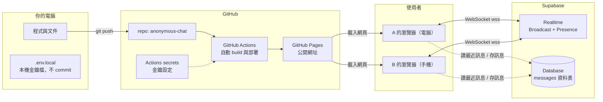
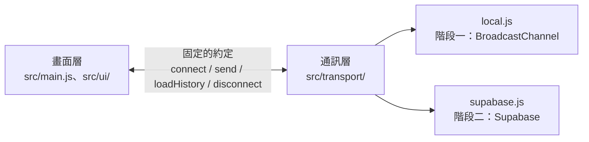
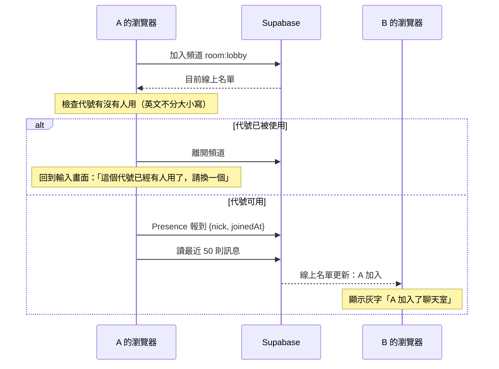

# 匿名聊天室 架構文件

> 給不寫程式的人看的版本。專有名詞第一次出現時，後面會用一句話解釋。
> 這份文件是根據 `docs/requirements.md` 和 grilling 問答的共識寫成的（共識整理在文末附錄）。

---

## 1. 專案說明與目標

一個**不用登入**的匿名聊天室。任何人打開網址、輸入一個代號，就能和所有線上的人在同一個聊天室裡即時聊天，電腦和手機都能用。

目標：

- 兩個瀏覽器（例如電腦和手機）互傳訊息，幾秒內就收到。
- 看得到誰在線上，有人進來或離開會有提示。
- 新進來的人看得到最近 50 則訊息。
- 別人送來的任何文字都只當「純文字」顯示，不會變成網頁的一部分。
- 網頁放在 GitHub Pages，免費、公開。

---

## 2. 整體架構圖



- **GitHub Pages**：GitHub 提供的免費網頁空間，只能放「靜態檔案」（HTML、CSS、JavaScript），沒有自己的伺服器程式。
- **Supabase**：一個雲端服務，提供資料庫和即時通訊，我們用它代替自己架伺服器。
- **WebSocket**：瀏覽器和伺服器之間「一直開著」的連線，伺服器可以隨時把新訊息推給瀏覽器；`wss` 是加密版。
- 重點：**訊息不經過 GitHub**。GitHub Pages 只負責把網頁送到你的瀏覽器，之後聊天都是瀏覽器直接和 Supabase 溝通。

---

## 3. 技術選擇

| 項目 | 選了什麼 | 為什麼 |
|---|---|---|
| 程式語言 | **JavaScript**（瀏覽器原生就看得懂的語言） | 不需要額外轉換，最容易除錯，學生之後要改也最好上手。 |
| 前端框架 | **不用框架（純 JavaScript + HTML + CSS）**，建置工具用 **Vite** | 這個聊天室只有兩個畫面，用 React 之類的框架（幫你管理複雜畫面的程式庫）反而多一層學習成本。Vite 是「把程式打包成可以放上網的檔案」的工具，速度快、設定少，也能幫我們讀取金鑰設定。 |
| 即時傳訊息 | **Supabase Realtime 的 Broadcast** | Broadcast（廣播）：一個人送出，Supabase 立刻轉給頻道裡所有人。延遲低，不用自己寫伺服器。 |
| 誰在線上 | **Supabase Realtime 的 Presence** | Presence（在場狀態）：每個瀏覽器向 Supabase 報到「我在」，有人加入或離開時，Supabase 通知所有人。瀏覽器關掉或斷線太久，Supabase 會自動把他移除。 |
| 保存最近訊息 | **Supabase Database（PostgreSQL）**，一張 `messages` 資料表 | 資料庫（存資料的地方）讓新進來的人可以讀到之前的訊息，也讓斷線的人連回來後補上漏掉的訊息。 |
| 連 Supabase 的程式庫 | `@supabase/supabase-js` | Supabase 官方的 JavaScript 程式庫，斷線會自動重連。**階段二才安裝。** |
| 部署 | **GitHub Actions → GitHub Pages** | GitHub Actions：每次 push 後，GitHub 自動幫你執行的流程。它會 build 網頁並放上 Pages。 |

---

## 4. 兩個階段

### 階段一：只有前端，不連 Supabase

- 完整做出所有畫面：輸入代號、聊天室、線上名單、進出提示、斷線提示。
- 通訊用「**本機模擬**」：同一個瀏覽器的多個分頁之間，用瀏覽器內建的 **BroadcastChannel**（同一個網站的分頁彼此傳話的功能）互傳訊息；最近訊息存在瀏覽器的 **localStorage**（瀏覽器自己的小儲存空間）。
- 在 GitHub Pages 上看得到、也能操作：在**同一個瀏覽器開兩個分頁**，各自輸入不同代號，就能互傳訊息、看到線上名單和進出提示。
- 做不到的：**不同的電腦或手機之間看不到彼此**（因為還沒有 Supabase 當中間人）。畫面頂端會顯示「本機示範模式」。

### 階段二：接上 Supabase

- 只把「本機模擬」換成「Supabase」：Broadcast 傳訊息、Presence 管線上名單、Database 存最近 200 則。
- 不同裝置之間可以互傳。
- 畫面的程式完全不動。

### 怎麼設計才不用整個重寫

程式分成兩層，中間用一份固定的「約定」（介面）接起來：



- **畫面層**只知道「送出一則訊息」「收到一則訊息」「線上名單變了」這些事，不知道背後是誰在傳。
- **通訊層**有兩個版本，長得一模一樣（提供相同的功能名稱）。`src/transport/index.js` 決定用哪一個。
- 階段二只需要：新增 `supabase.js`、修改 `index.js` 選用它。

通訊層提供的功能（約定）：

| 功能 | 說明 |
|---|---|
| `connect({ nick, clientId, handlers })` | 用代號進入聊天室。代號已被使用時回傳失敗。 |
| `send(message)` | 送出一則訊息。 |
| `loadHistory(limit)` | 讀最近 `limit` 則訊息。 |
| `fetchSince(time)` | 讀某個時間之後的訊息（斷線補訊息用）。 |
| `disconnect()` | 離開聊天室，馬上釋出代號。 |

`handlers` 是畫面層交給通訊層的「收到事情時要通知我」：`onMessage`、`onPresence`（線上名單）、`onJoin`、`onLeave`、`onStatus`（連線狀態）。

---

## 5. 通訊約定

### 頻道

- 所有人都在同一個頻道：`room:lobby`（階段一的 BroadcastChannel 也用這個名字）。

### 事件名稱

| 事件 | 誰送 | 內容 |
|---|---|---|
| `message` | 送訊息的人 | 一則訊息（格式見下） |
| `leave` | 按「離開」或關掉分頁的人 | `{ clientId, nick }`，讓別人立刻顯示「離開了」 |
| Presence `sync` / `join` / `leave` | Supabase 自動送 | 線上名單變化 |

### 訊息的資料格式

```json
{
  "id": "4b0c1c1e-8f7e-4b7c-9a5e-2f0d1a6c3e11",
  "nick": "小明",
  "text": "大家好",
  "ts": "2026-11-10T06:32:10.123Z",
  "clientId": "c0ffee00-1234-4abc-8def-001122334455"
}
```

| 欄位 | 意思 | 規則 |
|---|---|---|
| `id` | 訊息的唯一編號（UUID：幾乎不會重複的亂數編號） | 用來避免同一則訊息顯示兩次 |
| `nick` | 送出者代號 | 去掉前後空白後 1～12 個字 |
| `text` | 訊息內容 | 去掉前後空白後 1～500 個字，純文字 |
| `ts` | 送出時間（ISO 格式，世界標準時間） | 顯示時轉成當地時間的「時:分」 |
| `clientId` | 送出者這個分頁的編號 | 用來判斷「是不是我自己送的」 |

### Presence 回報的內容

```json
{ "clientId": "...", "nick": "小明", "joinedAt": "2026-11-10T06:30:00.000Z" }
```

`joinedAt` 用來處理兩人同時搶同一個代號：**先進來的人保留代號**，後來的人會被請回輸入畫面。

### 資料庫 `messages` 資料表（階段二）

| 欄位 | 型別 | 說明 |
|---|---|---|
| `id` | uuid | 主鍵 |
| `nick` | text | 代號 |
| `text` | text | 內容 |
| `client_id` | uuid | 分頁編號 |
| `created_at` | timestamptz | 送出時間 |

資料庫只保留最近 200 則，多的自動刪除。

---

## 6. 資料流

### 進入聊天室



### 送出訊息

1. A 按 Enter（電腦）或「送出」按鈕（手機）。
2. 前端檢查長度（1～500 字），產生 `id` 和 `ts`。
3. 先顯示在自己的畫面上（靠右）。
4. 用 Broadcast 送出 `message` 事件，同時存進資料庫。
5. B 收到後**先檢查格式**（欄位齊全、型別正確、長度符合），不合格就丟掉。
6. 合格的訊息用「純文字」方式放進畫面（靠左）。用 `id` 檢查，已經顯示過的不重複顯示。

### 離開

- **按「離開」按鈕**：送出 `leave` 事件、取消 Presence 報到、斷開連線 → 別人立刻看到「A 離開了聊天室」，代號立刻釋出。
- **直接關掉分頁**：瀏覽器關閉前會盡量送出 `leave`；送不出去的話，Supabase 在約 30 秒內偵測到連線消失，自動從線上名單移除。

### 斷線重連

1. 網路斷掉 → 頂端出現「連線中斷，重新連線中…」，輸入框鎖住，**已經打的字保留**。
2. supabase-js 自動重試連線。
3. 連回來後：重新 Presence 報到 → 用 `fetchSince(最後一則訊息的時間)` 從資料庫補上漏掉的訊息 → 解鎖輸入框。
4. 別人那邊：線上名單可能短暫少掉 A，但**30 秒內連回來的不顯示「離開／加入」提示**（畫面層會等 30 秒才顯示「離開了」，期間回來就取消）。

---

## 7. 畫面清單

### 畫面一：輸入代號

| 元素 | 行為 |
|---|---|
| 標題「匿名聊天室」與一句說明 | 純顯示 |
| 代號輸入框 | 預先填入上次用的代號（存在瀏覽器）；1～12 字；前後空白自動去掉 |
| 「進入聊天室」按鈕 | 檢查代號 → 連線 → 成功就切到聊天畫面 |
| 錯誤提示 | 例如「代號不能是空白」「最多 12 個字」「這個代號已經有人用了，請換一個」 |
| 連線中狀態 | 按下後按鈕顯示「連線中…」，避免重複按 |

### 畫面二：聊天室

| 元素 | 行為 |
|---|---|
| 標題列 | 聊天室名稱、目前人數（手機上點了展開線上名單）、「離開」按鈕 |
| 連線狀態列 | 斷線時出現「連線中斷，重新連線中…」；階段一顯示「本機示範模式」 |
| 線上名單 | 電腦：右側一直顯示；手機：預設收起。自己的代號後面標「（你）」 |
| 訊息列表 | 顯示最近訊息，新訊息自動捲到最下面（如果使用者正在往上看舊訊息就不強制捲動） |
| 一則訊息 | 代號 + 內容 + 時:分。自己的靠右、別人的靠左。同一人連續發的訊息合併，只在第一則顯示代號。每個代號依名字自動有固定顏色 |
| 日期分隔線 | 跨日時插入一條「2026/11/10」 |
| 系統提示 | 灰色小字「小明 加入了聊天室」「小明 離開了聊天室」，留在訊息之間 |
| 保留說明 | 訊息列表最上方「訊息只保留最近的 200 則」 |
| 輸入框 | 多行輸入。電腦：Enter 送出、Shift+Enter 換行；手機：Enter 換行。顯示剩餘字數。斷線時鎖住但保留文字 |
| 送出按鈕 | 空白時不能按 |

---

## 8. 金鑰

**金鑰**：一串很長的文字，像是進入 Supabase 的鑰匙。不同的金鑰權限不同。

| 金鑰 | 長相 | 權限 | 可以公開嗎？ | 放在哪裡 |
|---|---|---|---|---|
| Project URL | `https://xxxx.supabase.co` | 只是地址 | **可以** | 本機 `.env.local`；GitHub 的 Actions secrets |
| **Publishable key**（舊名 anon key） | `sb_publishable_...`（舊的是 `eyJ...` 開頭） | 只能做資料庫規則（RLS）允許的事 | **可以**放在前端，網頁裡本來就看得到 | 本機 `.env.local`；GitHub 的 Actions secrets |
| **Secret key**（舊名 service_role key） | `sb_secret_...` | **可以無視所有規則**，讀寫刪任何資料 | **絕對不行**，不能出現在程式、repo、網頁、聊天對話裡 | **這個專案完全不用**，留在 Supabase 後台就好 |
| 資料庫密碼 | 建立專案時設定 | 直接登入資料庫 | **絕對不行** | 只存在你自己的密碼管理器 |

- **RLS（Row Level Security，資料列安全規則）**：資料庫裡的規則，決定拿 publishable key 的人能讀什麼、寫什麼。我們設定成「大家都能讀訊息、能新增訊息，但不能修改或刪除」。正因為有 RLS，publishable key 公開也沒關係。

### 怎麼產生

1. 在 Supabase 網站建立專案時，Project URL、publishable key、secret key 會自動產生。
2. 在 Project Settings → API Keys 可以看到。我們只複製 **Project URL** 和 **publishable key**。

### 放在哪裡

- **本機**：專案根目錄的 `.env.local` 檔：
  ```
  VITE_SUPABASE_URL=https://xxxx.supabase.co
  VITE_SUPABASE_PUBLISHABLE_KEY=sb_publishable_xxxx
  ```
  Vite 會在 build 時把 `VITE_` 開頭的設定放進網頁。repo 裡另外放一份**沒有真正值**的 `.env.example` 當範本。
- **GitHub**：repo → Settings → Secrets and variables → Actions → **Repository secrets**，新增同名的兩個 secret。GitHub Actions build 時讀它們。

### 怎麼避免被 commit

- `.gitignore`（告訴 git「這些檔案不要管」的清單）裡有 `.env` 和 `.env.*`（但允許 `.env.example`），所以 `.env.local` 不會被 commit。
- 每次 commit 前執行 `git status` 確認沒有 `.env.local`。
- 上線前在整個 repo 搜尋 `sb_secret_`、`service_role`，確認沒有出現。
- 萬一 secret key 被 commit：**刪檔案不夠**（舊 commit 還看得到），要立刻到 Supabase 撤銷（rotate）那把金鑰，並重建 repo。

---

## 9. 安全與限制

### 別人可能送進來的奇怪東西，前端怎麼擋

| 狀況 | 處理方式 |
|---|---|
| 訊息裡有 HTML 或 `<script>` | **一律用純文字顯示**（程式只用 `textContent`，絕不用 `innerHTML` 放別人的內容），所以 `<b>` 會照字面顯示成 `<b>` |
| 格式錯誤、少欄位、型別不對 | 收到時先檢查，不合格直接丟掉 |
| 超長訊息、超長代號 | 收到時檢查長度，超過就丟掉；資料庫也有長度限制 |
| 很多空白或換行 | 去掉前後空白；畫面用 CSS 自動換行，不會撐破版面 |
| 網址 | 不轉成連結，避免釣魚 |
| 同一則訊息收到兩次 | 用 `id` 去除重複 |

### 這一版的已知限制（請注意）

- **代號可以被冒用**：沒有登入，代號只在「同一時間」不能重複。某人離開後，任何人都能用同一個代號，別人無法分辨是不是本人。
- **訊息不會永久保存**：資料庫只保留最近 200 則，更早的會被刪掉；也沒有備份。
- **沒有防洗版**：有人狂刷訊息的話，目前擋不住（列為已知風險）。
- **publishable key 是公開的**：任何人都可以拿它寫程式直接送訊息到聊天室（繞過我們的畫面），所以「收到時先檢查」非常重要。
- **代號檢查在前端進行**：極少數情況兩人同時按進入，會由「先進來的人」保留，後來的人被請回輸入畫面。

### Supabase 免費方案要注意的上限（數字以 Supabase 官方當時說明為準）

- 同時連線數有上限（約 200 個 Realtime 連線）。
- 每月 Realtime 訊息數有上限（約 200 萬則）。
- 資料庫容量約 500 MB（只存 200 則，遠低於上限）。
- **專案一週沒人使用會被自動暫停**，需要到 Supabase 後台按 Restore 恢復。評分前要確認專案是開啟的。

---

## 10. 這一版刻意不做的事

| 不做 | 為什麼 |
|---|---|
| 註冊、登入 | 需求明確說不需要 |
| 管理者、踢人、刪訊息 | 需要「管理者身分」，等於要有登入，跟匿名衝突 |
| 防洗版（限制發送速度） | 第一版先求能用；列為已知風險 |
| 傳圖片、檔案 | 需要 Supabase Storage 和更多安全檢查 |
| 網址變成可點連結 | 避免釣魚連結 |
| 多個聊天室、私訊 | 需求是單一聊天室 |
| 表情符號選單 | 手機輸入法本來就能打 emoji |
| 永久保存訊息 | 只保留 200 則，降低資料量與隱私風險 |

---

## 11. repo 的資料夾結構

```
anonymous-chat/
├─ .github/workflows/deploy.yml   # 自動部署到 GitHub Pages
├─ docs/
│  ├─ requirements.md             # 需求說明
│  ├─ architecture.md             # 本文件
│  └─ design.md                   # 視覺設計
├─ public/                        # 不需處理、直接複製的檔案（網站小圖示）
├─ src/
│  ├─ main.js                     # 程式進入點，串起畫面和通訊
│  ├─ style.css                   # 樣式
│  ├─ ui/
│  │  ├─ join.js                  # 輸入代號畫面
│  │  └─ chat.js                  # 聊天畫面
│  ├─ lib/
│  │  ├─ validate.js              # 代號、訊息的檢查
│  │  └─ util.js                  # 時間格式、代號顏色等小工具
│  └─ transport/
│     ├─ index.js                 # 決定用哪一個通訊方式
│     ├─ local.js                 # 階段一：本機模擬
│     └─ supabase.js              # 階段二：Supabase（階段二才新增）
├─ supabase/schema.sql            # 階段二：在 Supabase 建資料表與規則的 SQL
├─ .env.example                   # 金鑰範本（沒有真正的值）
├─ .gitignore
├─ CLAUDE.md                      # 給 Claude Code 的守則
├─ index.html
├─ package.json
├─ vite.config.js
└─ README.md
```

`node_modules/`（下載的程式庫）和 `dist/`（build 的產出）都在 `.gitignore` 裡，不會 commit。

---

## 12. 部署到 GitHub Pages 的方式

1. `vite.config.js` 設定 `base: '/anonymous-chat/'`，因為網址是 `https://<帳號>.github.io/anonymous-chat/`，網頁要知道自己在子路徑下。
2. `.github/workflows/deploy.yml`：每次 push 到 `main`，GitHub Actions 會
   1. 安裝 Node.js 和程式庫（`npm ci`）
   2. 從 Actions secrets 讀金鑰，執行 `npm run build` 產生 `dist/`
   3. 把 `dist/` 上傳並發佈到 GitHub Pages
3. 第一次需要在 repo → Settings → Pages → Build and deployment → Source 選 **GitHub Actions**。
4. 到 Actions 分頁看到綠色勾勾後，打開 `https://<帳號>.github.io/anonymous-chat/`。

---

## 13. 驗證清單

### 階段一（只有前端）

- [ ] `npm run build` 沒有錯誤。
- [ ] GitHub Pages 網址打得開，看到輸入代號畫面，頂端標示「本機示範模式」。
- [ ] 代號空白、超過 12 字時，會顯示錯誤，進不去。
- [ ] 同一個瀏覽器開兩個分頁，分別用「Amy」「Bob」進入，兩邊線上名單都有兩人，自己標「（你）」。
- [ ] 第二個分頁用「amy」進入，會顯示「這個代號已經有人用了」。
- [ ] A 送出訊息，B 立刻看到；自己的靠右、別人的靠左，有時:分。
- [ ] 同一人連續發的訊息合併，只顯示一次代號。
- [ ] 送出 `<b>粗體</b>`，對方看到的是原本的文字，沒有變粗、沒有跳出視窗。
- [ ] 電腦 Enter 送出、Shift+Enter 換行；超過 500 字不能送出。
- [ ] B 按「離開」，A 看到「Bob 離開了聊天室」，線上名單少一人；Bob 這個代號可以馬上再用。
- [ ] 重新整理後，代號已預先填好，按確認才進入，看得到剛剛的訊息。
- [ ] 手機尺寸（寬 375px）沒有左右捲動，線上名單可以展開收起。

### 階段二（接上 Supabase）

- [ ] 頂端不再顯示「本機示範模式」。
- [ ] 電腦和手機（或一般視窗 + 無痕視窗）互傳訊息，10 秒內收到。
- [ ] 兩邊線上名單都看得到對方；一邊按離開，另一邊名單更新並出現提示。
- [ ] 不同裝置用同一個代號（不分大小寫），第二個進不去。
- [ ] 新進來的人看得到最近的訊息（最多 50 則）。
- [ ] HTML 測試字串在另一台裝置上也是純文字。
- [ ] 關掉 Wi-Fi：出現「連線中斷，重新連線中…」，輸入框鎖住但文字保留；連回來後自動補上期間別人送的訊息。
- [ ] 關掉分頁（不按離開），另一邊約 30 秒內名單更新。
- [ ] `git log` 看得到先「frontend stage 1」再「connect Supabase」。
- [ ] repo 裡搜尋不到 `sb_secret_`、`service_role`，`.env.local` 沒有被 commit。
- [ ] Supabase 後台 `messages` 資料表最多 200 則。

---

## 附錄：grilling 共識整理

| 主題 | 決定 |
|---|---|
| 代號規則 | 1～12 字；中英文、數字、emoji 都可以；去前後空白；英文大小寫視為相同 |
| 同名 | 不允許，提示換一個；對方離線後可以再用 |
| 同一人多分頁、多裝置 | 一律當成不同人，同代號擋掉；有「離開」按鈕，按了馬上釋出；沒正常關掉的約 30 秒後釋出 |
| 重新整理 | 記住上次代號，預先填好，按確認才進入 |
| 訊息內容 | 純文字，上限 500 字；網址不轉連結；不另做 emoji 選單 |
| 送出方式 | 電腦 Enter 送出、Shift+Enter 換行；手機 Enter 換行，用送出按鈕 |
| 訊息顯示 | 代號 + 內容 + 時:分；連續訊息合併；代號固定顏色；跨日分隔線；自己靠右 |
| 歷史訊息 | 新人看到最近 50 則；資料庫保留最近 200 則並在畫面註明 |
| 線上名單 | 電腦側邊欄；手機收起、頂端顯示人數，點了展開；自己標「（你）」 |
| 進出提示 | 訊息之間的灰色小字，留在畫面上；30 秒內重連不顯示 |
| 斷線 | 頂端提示、鎖輸入框、保留文字、連回自動補訊息；超過約 30 秒才算離開 |
| 防洗版 | 第一版不做，列為已知風險 |
| 外觀 | 東華大學企管系配色：酒紅 `#9F0050` 主色、淡黃 `#FFE66F` 點綴、白／淺灰 `#F5F5F5` 底；深色模式跟隨系統 |
| 其他 | repo 公開；Supabase 免費方案；單一聊天室 |
